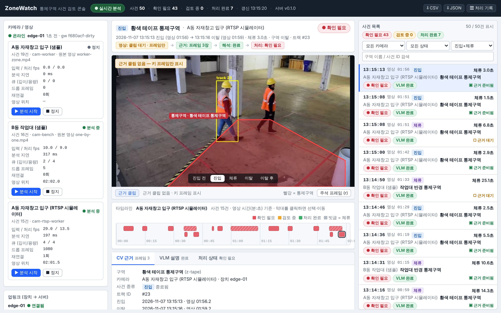

# SceneProof — 산업현장 제한구역 접근·체류 영상 사건 검토

**어느 카메라에서 어떤 일이 있었고, 어떤 장면을 근거로 확인이 필요하다고 판단했으며, 담당자가 어떻게 처리했는가** — 현장 관리자가 이 질문에 답할 수 있도록, CV가 사건을 만들고 VLM이 장면을 해석하고 사람이 검토하는 흐름을 하나로 연결한 서비스입니다.

[](https://github.com/sokldjs554/sceneproof/actions/workflows/ci.yml) [](https://github.com/sokldjs554/sceneproof/actions/workflows/k8s-runtime.yml)

> 노타 AI **[Solution] AI Software Engineer Intern (전환형)** 지원용 프로젝트입니다. 공고 항목별 대응은 [`docs/job-mapping.md`](docs/job-mapping.md)에 있습니다.
> 샘플 영상은 공개 데이터(Intel IoT DevKit CC BY 4.0, OpenCV Apache-2.0)이고, 성능 평가에는 연구용 공개 데이터(CAVIAR CC BY-SA, MOT16/20 CC BY-NC-SA 3.0)를 원 사이트에서 내려받아 씁니다(저장소에는 올리지 않음). 신원 식별 기능은 없습니다.

**공개 데모: [https://sokldjs554.github.io/sceneproof/](https://sokldjs554.github.io/sceneproof/)** — 저장된 실행 결과(사건 15건, 근거 클립·키 프레임, Claude Opus 5.5 해석, 처리 상태 전이)를 서버 없이 브라우저에서 재생하는 정적 페이지입니다. GitHub Pages(`pages` 워크플로)가 `demo/bundle`에서 생성합니다. 카메라 명령·실시간 분석·새 해석 생성은 아래 "바로 실행"의 로컬 서버(또는 `render.yaml`)에서만 동작합니다.



위 화면은 실시간 모드(mock 제공자)입니다. Claude Opus 5.5가 실제로 생성한 해석이 표시된 재생 모드 화면은 [`docs/images/replay-vlm/03_event_vlm.png`](docs/images/replay-vlm/03_event_vlm.png).

## 무엇을 하는가

1. 샘플 영상 또는 RTSP 스트림을 고른다 (콘솔 → 장치로 명령 전달).
2. 확인할 구역(다각형)과 조건(진입 확정 시간, 체류 시간)을 설정한다.
3. CV가 사람을 탐지·추적하고, 발 위치가 구역 안에 머무는 시간으로 **진입/체류 사건**을 만든다.
4. 사건 전후 3초의 클립과 근거 프레임(진입 직전·진입·체류·이탈·이탈 직후)을 자동으로 확보한다.
5. VLM이 근거 프레임을 보고 **보이는 것만** 구조화된 형식으로 설명하고, 판단의 한계를 적는다.
6. 담당자가 원본 장면과 설명을 보고 `확인 필요 → 검토 중 → 처리 완료`로 상태를 바꾼다. 같은 구역에 같은 시간 동안 있던 사건(여러 명이 함께 들어왔거나 한 사람이 둘로 나뉜 경우)은 목록에서 한데 묶여 보이고, 한 번에 처리할 수 있다(사건은 합치지 않음).
7. 사건·처리 결과·실행 조건(모델·설정 버전)을 조회하고 CSV/JSON으로 내보낸다. 사건 목록 API는 동시에 구역 안에 있던 사건만 골라 볼 수 있다(`concurrent_only`).

```
RTSP/파일 → [엣지 분석기: GStreamer → YOLOX(ONNX Runtime) → ByteTrack → 구역 상태머신 → 근거 클립]
          → [엣지 게이트웨이(Go): 내구 큐·재연결·업로드·하트비트] ──gRPC──▶ [검토 서버: SQLite·VLM 워커·API] → 관제 콘솔
```

상세 구조: [`docs/architecture.md`](docs/architecture.md) · 설계 결정과 대안: [`docs/design/decisions.md`](docs/design/decisions.md)

## 바로 실행

Python 3.11–3.13 권장(자동 검사는 3.12). 추론 라이브러리(onnxruntime)가 인텔 Mac에서는 Python 3.13까지만(macOS 11–12는 3.12까지), 3.15 이상은 아직 설치 파일이 없습니다. macOS 11(Big Sur) 인텔 Mac은 함께 동작하는 이전 버전 묶음(`constraints/macos11-intel.txt`, 그 버전으로 단위 테스트 통과 확인)으로 자동 설치됩니다. ffmpeg가 없으면 pip로 받는 `imageio-ffmpeg`의 ffmpeg를 씁니다(Homebrew로 직접 빌드하지 않아도 됨). `python3 scripts/check_python.py`가 미리 확인해 주고, `make setup PYTHON=python3.12`로 Python을 골라 한 번에 설치할 수 있습니다. 인텔 Mac에는 PyTorch 설치 파일이 없어, 설치는 PyTorch 없이 계속되고 모델은 YOLOX 공식 ONNX 파일을 받습니다(이 저장소에서 내보낸 것과 탐지 결과 동일, 점수 차이 0). 추가 학습과 PyTorch 비교만 못 합니다. Go가 없으면 게이트웨이 빌드만 건너뜁니다.

```bash
git clone https://github.com/sokldjs554/sceneproof.git && cd sceneproof
python3 scripts/check_python.py               # 이 Python으로 설치 가능한지 확인
python3 -m venv .venv && . .venv/bin/activate
pip install -e ".[server,dev,torch]"          # PyGObject(GStreamer)는 선택: pip install -e ".[gst]"
bash scripts/fetch_data.sh && bash scripts/fetch_models.sh
(cd gateway && make build)                    # Go 1.24

# 터미널 1: 서버(콘솔 http://127.0.0.1:8000)   터미널 2: 게이트웨이   터미널 3: 분석기
SP_SERVER_VLM_PROVIDER=mock sceneproof-server run
gateway/bin/sceneproof-gateway --listen :50051 --server 127.0.0.1:50052 --device-id edge-01 --queue-dir data/gateway --evidence-root data/evidence --http :9100 --insecure
sceneproof-edge --config configs/edge.yaml run --camera cam-bench
```

콘솔에서 카메라 행의 **분석 시작**을 누르면 샘플이 실시간 속도로 분석되고 사건이 쌓입니다. 분석기 없이 결과만 보려면 `sceneproof-server run --mode replay --replay-bundle demo/bundle` (화면에 "저장된 실행 결과 재생" 표시).
docker compose(`docker compose up --build`)와 Kubernetes(`scripts/k8s_verify.sh`)는 [`docs/ops/runbook.md`](docs/ops/runbook.md).

VLM 제공자: `mock`(형식 검증, 결과에 `[MOCK]` 표시) / `anthropic`(Claude, 구조화 JSON) / `openai_compat`(vLLM 등 자체 호스팅) / `transformers`(SmolVLM 로컬). 선택과 비용 상한은 runbook 참조.

## 결과 요약 (실측; 상세는 [`docs/eval/bench/README.md`](docs/eval/bench/README.md), [`docs/eval/README.md`](docs/eval/README.md))

- **연구용 벤치마크(사람이 손으로 그린 정답, 최종 분할 34편·27.5분·정답 사건 207건, 한 번 측정)**: CAVIAR·MOT 정지 카메라 86편(84편으로 시작해 두 번째 최종 분할용 2편 추가)을 학습/조정/최종으로 측정 전에 고정해 나누고, 데이터의 사람 상자를 제품과 같은 구역 규칙에 넣어 정답 사건을 만들었습니다. 제품 기본 모델은 찾은 비율 0.77·맞힌 비율 0.94였고, 위에서 내려다보는 로비에서 26건 중 7건만 찾았습니다. 같은 모델을 학습 분할로 CPU에서 추가 학습하자 **찾은 비율 0.96·맞힌 비율 0.94, 로비 26건 모두**를 찾았습니다. 본 적 있는 종류의 카메라에서는 놓침이 22건에서 1건이 됐습니다. 3배 큰 모델은 놓침을 줄였지만 잘못 울림이 늘었습니다. 표: [`docs/eval/bench/README.md`](docs/eval/bench/README.md), 해석: [`docs/eval/bench/findings.md`](docs/eval/bench/findings.md).
- **두 번째 최종 측정(어디에도 쓰지 않은 붐비는 밤 광장 2곳, 정답 사건 503건, 한 번 측정)**: 첫 측정 뒤 바꾼 것을 공정하게 재려고 새로 고정한 분할입니다. 기본 모델은 찾은 비율 **0.10**에 그쳤고, 추가 학습 모델은 **0.97**(맞힌 비율 0.99)이었습니다. 첫 측정에서 드러난 마네킹 헛알림은 **제외 영역** 기능으로(조정 분할 잘못 울림 5→1, 놓침 변화 없음), 학습 코드 결함은 다시 학습으로 고쳤습니다. 붐비는 장면에서 같은 출입이 여러 사건으로 쪼개지는 문제는 원인(같은 사람에게 추적 번호가 새로 붙음)을 찾아 **카메라별 붐비는 현장용 추적 설정**으로 약 40% 줄일 수 있게 했고(놓침 약 1% 증가라 기본값은 유지), 느슨한 사건 이어받기는 붐비는 장면에서 잘못 울림을 늘려 쓰지 않습니다. 시간당 잘못 울림은 영상이 짧아 아직 믿을 숫자가 아닙니다.
- **처음 만든 점검용 사건 평가(영상 4편, Claude 초안 → 사람 검수)**: 사람이 애매한 14곳을 사진으로 검수해 5곳을 고친 정답 기준으로, yolox_tiny(ONNX, CPU)는 침입 12건 모두 찾고 잘못 울림 0건·중복 6건 — 중복은 추적 번호가 바뀌어 한 사건이 쪼개진 것. nano는 원거리 자전거 탄 사람 2건을 놓쳐 10/12. 검수 내용: [`docs/eval/ground-truth.md`](docs/eval/ground-truth.md).
- **설정 실험(평가 영상 4편, [`docs/experiments/`](docs/experiments/README.md))**: 들어감 확인 시간을 0.3초에서 1.0초로 늘리면 찾은 침입이 12 → 9건, 놓침이 0 → 3건, 중복이 6 → 2건이 되어 기본값 0.3초를 유지합니다. 너무 작은 사람 상자를 무시하는 설정(`min_box_height_px`, 기본 끔)을 40px로 켜면 사건 판정은 같고 주차장 영상의 종료 시각만 달라졌습니다(기본 3회·40px 2회 반복 실행으로 설정 때문임을 확인).
- **추론 성능(4 vCPU, 3회 반복 중앙값)**: yolox_tiny 추론 p50 — PyTorch 44.6 ms → ONNX Runtime 21.6 ms(그래프 최적화 끔 32.1 ms); nano 26.8 → 8.6 ms; s 123.3 → 69.8 ms. 변환 전후 NMS 결과 상자·점수 차이 0(150프레임). 표와 반복 변동은 docs/eval/README.md §2. **GPU(Colab T4)**: tiny 추론 p50 TensorRT FP32 3.5 ms, FP16 2.7 ms(ONNX Runtime GPU 4.8 ms, PyTorch GPU 11.2 ms). FP32는 CPU와 찾은 상자가 같고, FP16으로 바꿔도 평가 영상 4편의 사건 판정은 같았습니다(전체 분석 13~19배 빠름). [`docs/eval/gpu.md`](docs/eval/gpu.md)
- **스트림 수 증가(tiny, 4 vCPU)**: 1스트림 28.6 fps(입력 30), 4스트림 합계 34 fps·스트림당 8.5 fps, 지연 p95 180 → 560 ms, 큐 깊이 상한(4) 유지·폐기 프레임 증가 — §3.
- **실시간·장애 대응**: 과입력(입력 30 fps·1스레드 → 처리 19 fps, 폐기 417, 지연 최대 202 ms), 스트림 단절·복구(RTSP 14초 단절 → 4초 만에 재연결), VLM 지연·실패(수신 ack p95 2.7 ms 유지, 타임아웃·재시도·재요청), 장치–서버 단절(큐잉 → 재전송, 중복 0), 중복 전달, 재시작 — 6가지 모두 스크립트로 재현·통과. 이 과정에서 VLM 워커의 실제 버그 2개를 찾아 고침(`docs/dev-log.md` L9–L10). §4와 [`docs/evidence/failure-scenarios/`](docs/evidence/failure-scenarios/).
- **CV만 vs CV+VLM(Claude Opus 5.5, held-out 19건, CI 실행, 프롬프트 2회)**: 두 실행 모두 해석 19/19 완료(스키마 위반 0, p50 약 20초, 각 약 $1). 프롬프트 v1.2(assessment 값만 열거)에서는 정답 침입 10건 중 '확인 필요' 유지 4건, '정상 가능성 높음' 3건 — 모델이 '위험해 보이는가'로 판단해 기하학적 침입 정답과 어긋났습니다. 규칙을 한 문장 적은 v1.3(구역 안 확인=확인 필요, 경계·불명=불확실)에서는 8건 유지·'정상' 0건, 대신 경계 통과 3건 중 2건이 '확인 필요'로 올라갔습니다(보수적). CV의 잘못 울림 1건은 두 버전 모두 '구역 안의 사람'을 봤다고 했는데, 확인해 보니 정답 사건과 같은 자전거 탄 사람이 화면 끝에서 새 추적 번호를 받은 조각이었습니다. **정답을 사람이 검수한 뒤** 다시 맞춰 보니 v1.2가 '경계 통과'라 '정상'으로 본 2건이 실제 침입이어서, 정답 침입 12건 중 '정상 가능성 높음'으로 빠진 것이 v1.2 4건, v1.3 0건(유지 9건)입니다. **결론: 문제는 모델의 시각이 아니라 계약(프롬프트)의 빈칸이었고, VLM 판단은 보조 표시로만 쓰며 모든 사건을 '확인 필요'로 유지하는 설계(D7)는 그대로입니다.** 같은 19건으로 재측정한 비교라, **처음 보는 영상**(연구용 조정 분할 12편, 18건, 측정 규칙을 실행 전에 고정)으로 다시 쟀습니다: 정답 침입 14건 중 '정상'으로 뺀 것 0건(확인 필요 9·불확실 5), CV 잘못 울림 2건(마네킹)은 '불확실'로 두며 "사람인지 마네킹인지 판별되지 않는다"고 적음. 사람 채점(2명이 따로, 19건): 관찰이 사진과 맞음 두 사람 모두 19/19, 지어낸 내용 0건, 불확실한 점 타당 19/19 — 두 사람의 답이 19건 모두 같음. 사례·전후 비교는 [`docs/eval/vlm-findings.md`](docs/eval/vlm-findings.md), 원시 결과는 `docs/eval/raw/vlm_eval*.json`.

## 기술 선택 (왜)

| 영역 | 선택 | 이유 (대안·한계는 decisions.md) |
|---|---|---|
| 탐지 | YOLOX nano/tiny/s (Apache-2.0) → 자체 ONNX 내보내기 | 라이선스가 명확하고, PyTorch/ONNX를 같은 전후처리로 비교 가능. CPU 4코어에서 tiny가 30fps 입력을 처리 |
| 추적 | ByteTrack 자체 구현 | 체류 시간은 ID 안정성에 달림. 저신뢰 상자 2차 연계를 테스트로 고정 |
| 구역 판정 | 발 위치 앵커 + 시간 기반 디바운스 + 추적 끊김 유예 + 하단 클리핑 보정 | 평가 데이터에서 발견한 실패(사건 쪼개짐)를 고친 결과 |
| 입력 | GStreamer(rtspsrc/appsink), OpenCV 대체 경로 | RTSP 재연결·백오프, 파일은 실시간 페이싱 |
| 엣지↔서버 | Protobuf/gRPC 단일 계약, Go 게이트웨이 | 사건은 스냅샷+revision → 멱등·병합·재전송이 한 규칙 |
| VLM | 서버 비동기 워커, 범주형 구조화 출력, 예산 상한 | 분석·기록은 VLM과 무관하게 진행; 확률·신뢰도 미표시 |
| 저장·배포 | SQLite(WAL), Docker/compose/k8s 매니페스트, CI | 단일 서버 데모에 충분; 재시작 복구 검증 |
| 평가 | 사람이 그린 상자를 제품과 같은 구역 규칙에 넣어 정답 사건 생성, 측정 전 분할 고정, 최종 1회 잠금 | 정답과 예측의 차이를 '누가 상자를 그렸나' 하나로 줄이고, 결과를 보고 설정을 바꿀 수 없게 함(D11) |
| 추가 학습 | 같은 YOLOX-tiny를 CPU로 추가 학습 → ONNX | 모델 크기·추론 경로를 그대로 두고 가중치만 교체. 큰 모델로 바꾸면 헛알림이 늘었음(D12) |

## 범위와 한계

- NVIDIA 장비가 없는 환경에서 만들었습니다. TensorRT는 탐지기 백엔드(`TensorRTBackend`, FP32·FP16)를 추가해 **Colab T4에서 실행 검증**했습니다([`docs/eval/gpu.md`](docs/eval/gpu.md)): tiny 추론 p50 CPU(2코어) 69ms → TensorRT FP32 3.5ms → FP16 2.7ms, 평가 영상 4편의 사건 판정은 CPU와 TensorRT FP16이 **똑같았고** 전체 분석은 13~19배 빨라졌습니다. Jetson 같은 엣지 장치·DeepStream·vLLM은 설정 경로와 클라이언트만 준비했고 **실행·측정하지 않았습니다**.
- Kubernetes는 GitHub Actions의 kind 클러스터에서 배포·서버 파드 삭제 복구·엣지 파드 삭제 복구·중복 없음 검사를 통과했습니다([k8s-runtime 실행](https://github.com/sokldjs554/sceneproof/actions/runs/42402112637)). 개발 샌드박스 자체에서는 중첩 컨테이너 런타임 제약으로 kind/k3s 파드가 뜨지 않았습니다(증적 보존).
- 처음 만든 4편 평가의 정답은 같은 계열 탐지기 초안에서 출발했고, 사람은 애매한 14곳만 검수했습니다(영상 전체를 처음부터 따로 표시하지는 않음). 주 평가(연구용 벤치마크)의 정답은 데이터셋 작성자가 손으로 그린 상자에서 만들었고, 4명이 2명씩 짝지어 영상 10편을 따로 표시해 비교했습니다(로비·복도 9편: 사람끼리 사건 F1 0.98, 사람–정답 차이는 주로 '영상 시작 때 이미 있던 사람'과 '동시에 있는 여러 명'을 세는 방식; 매장 정면 화면은 사람도 출입을 판단하지 못함). 10편·4명이라 표본은 작습니다.
- 평가 데이터는 로비·쇼핑몰·거리·기차역·광장입니다. 공장, 안전모·조끼, 지게차가 있는 장면에서 사람이 정답을 그린 공개 영상은 찾지 못했습니다(공장 장면이 있는 KAIST MTMMC는 서명한 동의서를 저자에게 보내 승인받아야 하고 비상업 학술 연구로 한정되어, 공개 포트폴리오에는 쓰지 않음 — `docs/eval/bench/findings.md`). 최종 측정 영상이 짧아 시간당 잘못 울림은 아직 믿을 숫자가 아닙니다.
- 수십~수백 명이 겹치는 장면에서는 추적 번호가 바뀌어 같은 출입이 여러 사건으로 나뉘는 일이 남습니다. 붐비는 현장용 설정으로 약 40% 줄지만, 근본적으로는 겉모습을 비교하는 추적 모델(GPU 전제)이 필요합니다([`findings.md`](docs/eval/bench/findings.md)). 학습 데이터에 비상업 조건 데이터가 있어 추가 학습 가중치는 연구·비상업 용도로만 씁니다.
- 선반·물건에 발이 가리면 앵커가 지면 위치가 아니어서 구역 판정이 흔들립니다(매장 영상). 구조적 한계로 기록했습니다.
- 사건 목록의 `concurrent_only`는 묶음을 전체 사건으로 먼저 계산하므로 요청마다 모든 사건을 읽습니다(합성 사건 5,000건에서 기본 조회 67ms, 이 조건 503ms — `scripts/bench_event_list.py`, `docs/eval/raw/api_event_list_bench.json`). 반대로 기본 목록은 돌려주는 행 안에서만 묶어서, 처리 상태로 걸러 보면 묶음 정보가 줄거나 사라질 수 있습니다. 거의 이어진 사건까지 묶는 `gap_s`는 함수 옵션으로만 있고 API·화면에는 연결하지 않았습니다.
- 인증·TLS·다중 테넌트·다중 서버 확장은 범위 밖입니다.

## 문서

| 문서 | 내용 |
|---|---|
| [docs/job-mapping.md](docs/job-mapping.md) | 공고 전체 항목 대응표(검증 상태 포함) |
| [docs/architecture.md](docs/architecture.md) | 구조, 사건 생애주기, 스레드·큐, 시간의 종류 |
| [docs/design/decisions.md](docs/design/decisions.md) | 설계 결정·대안·미채택 기술 |
| [docs/eval/gpu.md](docs/eval/gpu.md) | GPU(TensorRT) 측정 — Colab T4 노트북, 결과와 다음 병목 |
| [docs/experiments/](docs/experiments/README.md) | 설정 실험: 들어감 확인 시간 0.3초 vs 1.0초, 최소 사람 상자 높이 40px |
| [docs/eval/bench/README.md](docs/eval/bench/README.md) · [findings.md](docs/eval/bench/findings.md) | 연구용 벤치마크: 장소별 사건 성능, 추가 학습 전후, 최종 1회 측정(자동 생성) · 결과 읽는 법과 소견 |
| [docs/eval/README.md](docs/eval/README.md) | 추론 속도·스트림 수·장애 시나리오·CV+VLM 비교 결과(자동 생성) |
| [docs/eval/vlm-findings.md](docs/eval/vlm-findings.md) | Claude 해석 실측 소견(프롬프트 v1.2 → v1.3) |
| [tools/event_labeler/index.html](tools/event_labeler/index.html) | 사람이 사건을 표시하는 도구(두 사람 일치도용) |
| [docs/eval/ground-truth.md](docs/eval/ground-truth.md) | 정답 기준·작성 방법·남은 검수 |
| [data/README.md](data/README.md) | 데이터 출처·라이선스·분할 |
| [docs/ops/runbook.md](docs/ops/runbook.md) · [failure-modes.md](docs/ops/failure-modes.md) | 실행·상태 확인·복구 |
| [docs/dev-log.md](docs/dev-log.md) | 발견한 실패·원인·수정 전후, 리팩토링 |
| [docs/code-review-guide.md](docs/code-review-guide.md) | 읽을 순서·입출력·판단 지점·직접 해 볼 항목 |
| [docs/papers-and-docs.md](docs/papers-and-docs.md) | 논문·공식 문서 요약과 적용·재현 범위 |
| [gateway/README.md](gateway/README.md) | Go 게이트웨이 설계 |

## 라이선스

코드: Apache-2.0. 벤더링한 YOLOX 모델·학습 손실 코드: Apache-2.0(Megvii). 샘플 영상: CC BY 4.0(Intel IoT DevKit), Apache-2.0(OpenCV). 평가 데이터(저장소에 없음): CAVIAR CC BY-SA, MOT16/20 CC BY-NC-SA 3.0 — 이 데이터로 추가 학습한 가중치는 비상업 용도. 자세한 출처는 [`data/README.md`](data/README.md), [`THIRD_PARTY_NOTICES.md`](THIRD_PARTY_NOTICES.md).
