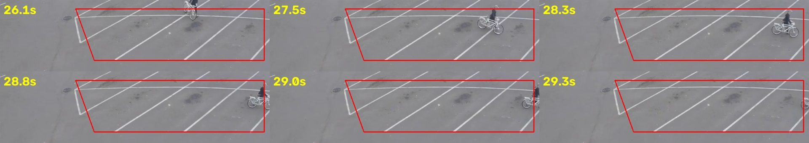

# 평가 정답(Ground Truth) — 작성 방법, 기준, 사람 검수

정답 파일: `data/ground_truth/<camera_id>.yaml` (형식은 `src/sceneproof/eval/gt.py` 상단 주석).

## 사건의 정의

- **사건(episode)**: 한 사람이 한 구역 다각형 안에 발(상자 하단 중앙)을 두고 있는 연속 구간.
- **시작(start_s)**: 발이 다각형 안으로 들어온 첫 프레임의 미디어 시간. **종료(end_s)**: 다각형 안에서 보인 마지막 프레임, 또는 시야에서 사라진 시각.
- **체류(dwell)**: 구간 길이가 `dwell_seconds`(5초) 이상.
- **라벨**
  - `intrusion`: 발이 분명히 구역 안. 평가의 양성(positive).
  - `boundary_pass`: 발이 경계선 위/바로 밖을 따라 이동. 양성도 음성도 아님 — 여기에 겹치는 예측은 FP로 세지 않고 `boundary_hits`로 따로 보고.
  - `occluded`: 발이 물건·선반에 가려 지면 위치를 판단할 수 없음. 위와 같이 처리.
  - `unsure`: 주석자가 판단하지 못함(현재 없음).
- **정상 상황(negatives)**: 알림이 없어야 하는 구간의 설명(차량 통과, 구역 밖 통행 등). 수치에는 FP/h로 반영.

## 매칭과 분모 (`src/sceneproof/eval/metrics.py`)

- 예측과 정답은 시간 겹침으로 매칭: 겹침 ≥ min(0.5s, 짧은 쪽 길이의 절반) 또는 시작 시각 차 ≤ 1.0s. 겹침이 가장 큰 정답을 택하고, 동률이면 intrusion 우선(보수적: 중복으로 집계).
- 한 정답에는 예측 하나만. 추가 예측은 **duplicates**(ID 스위치·추적 끊김으로 쪼개진 사건). 중복은 precision 분모에서 빼고 따로 센다.
- precision = TP/(TP+FP), recall = TP/(TP+missed). FP/h = FP / 영상 시간(시간). 시작·종료 MAE는 TP 쌍의 절대 오차 평균(초).
- 같은 시간대에 여러 사람이 구역 안에 있으면 시간만으로는 매칭이 모호합니다(매장 영상). 위치 정보를 쓰지 않는 현재 규칙의 한계이며, 그런 예측은 중복으로 집계됩니다.

## 작성 방법(이번 세션)

1. `configs/eval.yaml`의 구역을 **탐지 결과를 보기 전에** 영상 격자 프레임을 보고 정의.
2. 강한 설정(yolox_s@640, conf 0.3, 무손실 오프라인)으로 초안 사건 생성 → `scripts/review_sheets.py`로 사건별 키프레임 시트 → 육안 검토.
3. 애매한 장면은 확대 크롭으로 재확인(원거리 자전거, 경계선 보행, 가림).
4. `scripts/zone_occupancy.py`(모든 프레임, 추적·디바운스 없이, conf 0.2)로 구역 점유 세그먼트를 만들어 초안이 놓친 구간이 있는지 대조.
5. 시작·종료 시각은 초안 사건 시각과 점유 세그먼트를 절충(±0.5s 정도의 불확실성).

**주석자**: Claude가 초안을 만들고, 사용자(저장소 주인)가 확인할 곳 14개를 검수했습니다(2026-11-11). 정답 파일의 `annotation.status: reviewed`이며, 바꾼 것은 `review_changes`, 확인만 한 것은 `review_kept`에 적혀 있습니다.

## 사람 검수 결과 (2026-11-11)

검수는 사진과 버튼으로 답하는 페이지 [`tools/review/gt_review.html`](../../tools/review/gt_review.html)로 했습니다. 질문마다 대상 인물을 색 상자로 표시하고, 시각 질문은 후보 시각 사진 중 하나를 고르게 했습니다. 14개 중 5개를 고쳤고 9개는 초안을 그대로 확인했습니다.

| 영상 | 고친 것 | 그대로 확인한 것 |
|---|---|---|
| campus | e01·e04 경계 통과 → **침입**(발이 잔디 안으로 들어감) | e03은 발이 화면 아래로 잘린 58–62초도 한 사건 · 52–60초에 세 번째 인물 없음 |
| indoor | — | e04 시작 시각 |
| store | e01·e02 → **한 사건**(28.9–65.4초, 42.7–47.9초에도 계속 구역 안) | e03 가림 구간은 판단 불가(`occluded`) · 초록 상의 인물은 구역에 안 들어감 · 구역은 직원 전용(고객이 들어가도 알림) |
| parking | e02 경계 통과 → **침입** · e03 시작 45.8 → **45.5초** | e01 시작·종료, e03 종료 |

검수 뒤 저장한 예측을 다시 채점했습니다(분석은 다시 돌리지 않음; `python -m sceneproof.eval.rescore docs/eval/raw/event_eval_<variant>.json`). 정답 침입이 10건에서 12건으로 늘고 경계 통과가 3건에서 0건이 되었습니다. 기본 모델 yolox_tiny는 12/12, yolox_nano는 주차장 자전거 2건을 놓쳐 10/12입니다(`README.md` §1).

**VLM 실행에서 나온 질문 두 개도 정리했습니다.**

- **주차장 사건 `1d48e2c7…`(채점상 '잘못 울림')**: 정답은 맞습니다. 이 사건은 정답 e01(자전거 탄 사람, 27.0–29.0초)과 **같은 사람**이 화면 오른쪽 끝에서 새 추적 번호를 받아 28.8초에 다시 생긴 조각입니다(아래 사진, 26.1–29.3초에 자전거 탄 사람은 한 명뿐). 정답 사건과 겹치는 시간이 0.2초뿐이라 매칭 규칙(겹침 0.5초 이상 또는 시작 차 1초 이내)으로는 중복이 아니라 잘못 울림으로 셉니다. 규칙은 결과를 본 뒤 바꾸지 않았으므로 숫자는 그대로 두고, 실제로는 같은 침입의 중복이라는 점만 여기에 적습니다. Claude가 "구역 안에 자전거와 함께 있는 사람"을 봤다고 쓴 것은 맞는 관찰입니다.
- **매장 구역의 의미**: 사용자가 "직원 전용 — 고객이 들어가도 알림"으로 확정했습니다. 정답 라벨 `intrusion`의 정의와 일치합니다.

## 독립성에 대한 주의

정답 초안이 같은 계열의 탐지기(YOLOX-s)에서 출발했으므로, 탐지기 자체가 놓치는 사람(예: 원거리 소형 객체)은 정답에서도 빠질 수 있습니다. 점유 검사(conf 0.2)와 육안 검토로 보완했고 사람이 애매한 14곳을 검수했지만, 사람이 영상 전체를 처음부터 따로 표시한 것은 아니므로 완전한 독립 라벨링은 아닙니다. 그래서 주 평가는 데이터셋 작성자가 손으로 그린 상자로 만든 연구용 벤치마크(`README.md` 앞부분)이고, 이 4편은 제품 전체 흐름(CV → 근거 → VLM → 검토)을 점검하는 용도입니다.
